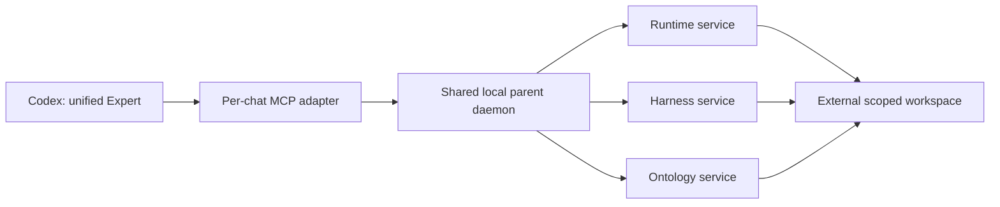

# EvoPilot 0.7.0 Preview candidate

Build domain models, assess quality, and prepare controlled execution through one Expert in Codex. Runtime owns execution and state, Harness owns QA and delivery standards, and Ontology owns domain modeling.

[Quickstart](docs/installation.md) · [Documentation](docs/README.md) · [Downloads](https://github.com/yeliang-wang/evopilot/releases) · [Contribute](CONTRIBUTING.md)

This edition is **0.7.0 Preview**: [conversation-driven planning](docs/planning.md), [table-first native asset and gate reports](docs/readable-assets.md), and [preflight, diagnostics and bounded maintenance](docs/preflight-maintenance.md). Exact source, downloads and publication status are recorded by the versioned Release; local installation is a separate operation.

Earlier v0.6.0 introduced [reviewed response linkage](docs/response.md), extending online Harness and registered execution feedback. It connects findings, published runbooks, reviewed isolated actions, independent verification and asset-owner feedback. Use the [versioned release](https://github.com/yeliang-wang/evopilot/releases/tag/v0.6.0) for published artifacts; source availability alone is not a publication receipt. Native domain models use RDF/Turtle and SHACL; quality assets use Rego, OPA and Conftest. Project completion requires fixed requirements, actual collection receipts, both owner reports and the actual domain decision. Preview is not GA or blanket production acceptance.

## What can I do?

| Scenario | Unified Expert path | Result to review |
| --- | --- | --- |
| Discuss a future version | [Planning and review](docs/planning.md) | Versioned ideas, assumptions, questions, decisions and milestone bindings |
| Read rules and gate results | [Readable assets](docs/readable-assets.md) | Typed tables, before/after values and exact evidence with unchanged native standards |
| First use | Initialize your own Workspace | Editable project directory, separate protected service state, README and synthetic examples |
| Design from requirements | Forward design | Concepts, relations, constraints and proposed mappings |
| Understand an existing project | Reverse modeling of an authorized revision | Observed mappings, inferences and semantic gaps |
| Assess quality | Harness quality assessment | Rules, evidence, missing reports and quality results |
| Evolve reviewed assets | [Registered execution feedback](docs/feedback.md) | Durable Run evidence, owner impact proposals, exact-version reuse or native delivery |
| Monitor a selected service | [Online Harness](docs/online-harness.md) | Measured SLO windows, native policy results, incidents and reviewable Runtime repair candidates |
| Respond to a retained fault | [Reviewed response](docs/response.md) | Pinned runbook and action, independent recovery evidence, reviewed asset reuse or delivery |
| Plan and execute a goal | Runtime plan/execute | Immutable inputs, decisions, receipts and reconciliation |

Missing, unknown, skipped or stale required evidence blocks completion. Warnings do not authorize an automatic version bump. The current native workflow separates execution status from semantic and quality results; standalone Runtime needs trusted providers. Arbitrary coding and deployment are unsupported. Start with the [native workflow](docs/native-workflow.md), [project standard](specifications/project/v1/README.md) and [locked toolchain](docs/native-toolchain.md).

## Three products, one entry

| Repository | Responsibility | Documentation | Releases |
| --- | --- | --- | --- |
| [EvoPilot parent](https://github.com/yeliang-wang/evopilot) | Composition, unified Expert and distribution; Codex plugin is Runtime integration, not a fourth product | [Guides](docs/README.md) | [Preview releases](https://github.com/yeliang-wang/evopilot/releases) |
| [Runtime](https://github.com/yeliang-wang/evopilot-runtime) | Projects, goals, execution, state, decisions and audit | [API](https://github.com/yeliang-wang/evopilot-runtime/blob/main/docs/service.md) | [Preview releases](https://github.com/yeliang-wang/evopilot-runtime/releases) |
| [Harness](https://github.com/yeliang-wang/evopilot-harness) | QA, evidence, evaluation and delivery standards | [Guide](https://github.com/yeliang-wang/evopilot-harness/blob/main/README.md) | [Preview releases](https://github.com/yeliang-wang/evopilot-harness/releases) |
| [Ontology](https://github.com/yeliang-wang/evopilot-ontology) | Domain concepts, relations, modeling, builds and immutable deliveries | [Guide](https://github.com/yeliang-wang/evopilot-ontology/blob/main/README.md) | [Preview releases](https://github.com/yeliang-wang/evopilot-ontology/releases) |



The daemon loads all three services; it does not start one process per product. An explicitly enabled online worker runs independently under launchd and uses the same public owner APIs. It continues after Codex closes; [stop it before maintenance](docs/online-harness.md). See [process topology](docs/architecture/0002-local-process-topology.md).

## Install a published bundle

Use **Node 24.14.0**. Get `evopilot-0.7.0-preview.tar.gz` and `SHA256SUMS` from the exact [v0.7.0 release](https://github.com/yeliang-wang/evopilot/releases/tag/v0.7.0). Follow [checksum verification and extraction](docs/installation.md), then set canonical absolute paths to your extracted bundle and new isolated locations outside Git; their parent directories must exist. Public and private product data belong to the workspace, separate from installed program files:

```sh
preview_bundle="/absolute/path/to/extracted-bundle"
preview_root="/absolute/path/to/new-preview-program"
node "$preview_bundle/app/scripts/manage-preview.mjs" install --bundle "$preview_bundle" --root "$preview_root" --installation-id preview-install
node "$preview_bundle/app/scripts/manage-preview.mjs" doctor --root "$preview_root"
codex plugin marketplace add "$preview_root" --json
codex plugin add evopilot-v01-preview@evopilot-v01-preview-local --json
```

Existing users should follow the [v0.6 to v0.7 upgrade procedure](docs/migration.md#upgrade-from-v06-to-v070) before switching their daily plugin. Preserve the existing Workspace and verify rollback on an isolated copy.

Select **EvoPilot v0.7 Preview**, then say: “Initialize my private Workspace, explain its directories, and guide me through the forward example.” The Expert inspects first, creates the Workspace only after your setup request, then explicitly activates the current chat. You can choose your own directories; no private GitHub repository is required. Initialization alone does not activate the chat. Inspect and guide requests stay passive; ordinary chats do not require EvoPilot.

Your editable project defaults to `~/evopilot-workspace`; protected service state defaults to `~/.local/share/evopilot/workspaces/<id>`. The project may have its own private Git history. Service databases, control records, signing keys and private evidence stay outside EvoPilot source and distribution. See [Workspace](workspace/README.md) and the [current and historical Expert scenarios](docs/expert-scenarios.md).

For the current release, use the [native workflow](docs/native-workflow.md) and [current Expert journeys](docs/expert-scenarios.md). Its native validator platform is macOS arm64 with an explicit locked-toolchain preparation step; inspection never downloads dependencies. The legacy JSON authoring, classification and Catalog mutation routes are read-only historical compatibility. They cannot certify the corrected v1. Use [source development](docs/development.md) for this checkout and [recovery](docs/recovery.md) before changing installations.

For help, use [support](SUPPORT.md); for sensitive reports, read [security](SECURITY.md). Licensed under [Apache-2.0](LICENSE); attribution is in [NOTICE](NOTICE).

Native approvals bind readable, digest-pinned evidence to the exact review, Workspace and operation. See [decision evidence](docs/native-decisions.md) for the format, historical readback and trusted-operator boundary.

Implementation language responsibilities and source checks: [language policy](docs/language-policy.md).

## Planning and readable evidence

v0.7 adds [conversation-driven planning](docs/planning.md), [business-readable plans, assets and gate evidence in Codex](docs/readable-assets.md), and [preflight/recovery improvements](docs/preflight-maintenance.md). Native v1 standards and immutable history remain unchanged. Read the migration guide before switching an existing Workspace; publication does not automatically update running chats.
