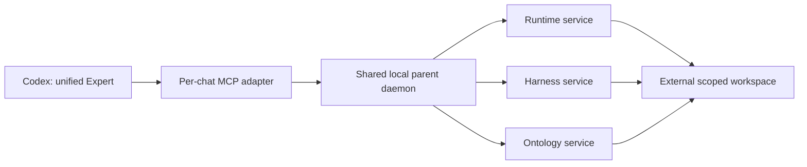

# EvoPilot 0.2.0 Preview

Build domain models, assess quality, and prepare controlled execution through one Expert in Codex. Runtime owns execution and state, Harness owns QA and delivery standards, and Ontology owns domain modeling.

[Quickstart](docs/installation.md) · [Documentation](docs/README.md) · [Downloads](https://github.com/yeliang-wang/evopilot/releases/tag/v0.2.0) · [Contribute](CONTRIBUTING.md)

0.2.0 Preview adds conversation-based private Workspace setup, project baselines and migration/recovery to the three-product workflow. Preview is not GA or blanket production acceptance. Review drafts and evidence before making business or publication decisions.

## What can I do?

| Scenario | Unified Expert path | Result to review |
| --- | --- | --- |
| First use | Initialize your own Workspace | Editable project directory, separate protected service state, README and synthetic examples |
| Design from requirements | Forward design | Concepts, relations, constraints and proposed mappings |
| Understand an existing project | Reverse modeling of an authorized revision | Observed mappings, inferences and semantic gaps |
| Assess quality | Harness quality assessment | Rules, evidence, missing reports and quality results |
| Plan and execute a goal | Runtime plan/execute | Immutable inputs, decisions, receipts and reconciliation |

Missing evidence stays INDETERMINATE with Warning; it does not become PASS or trigger an automatic version bump. The installed parent can execute its deterministic Ontology validation and supplied-evidence Harness evaluation. Standalone Runtime requires trusted providers; arbitrary coding and deployment are unsupported.

## Three products, one entry

| Repository | Responsibility | Documentation | Releases |
| --- | --- | --- | --- |
| [EvoPilot parent](https://github.com/yeliang-wang/evopilot) | Composition, unified Expert and distribution; Codex plugin is Runtime integration, not a fourth product | [Guides](docs/README.md) | [0.2.0 Preview](https://github.com/yeliang-wang/evopilot/releases/tag/v0.2.0) |
| [Runtime](https://github.com/yeliang-wang/evopilot-runtime) | Projects, goals, execution, state, decisions and audit | [API](https://github.com/yeliang-wang/evopilot-runtime/blob/main/docs/service.md) | [0.2.0 Preview](https://github.com/yeliang-wang/evopilot-runtime/releases/tag/v0.2.0) |
| [Harness](https://github.com/yeliang-wang/evopilot-harness) | QA, evidence, evaluation and delivery standards | [Guide](https://github.com/yeliang-wang/evopilot-harness/blob/main/README.md) | [0.2.0 Preview](https://github.com/yeliang-wang/evopilot-harness/releases/tag/v0.2.0) |
| [Ontology](https://github.com/yeliang-wang/evopilot-ontology) | Domain concepts, relations, modeling, builds and immutable deliveries | [Guide](https://github.com/yeliang-wang/evopilot-ontology/blob/main/README.md) | [0.2.0 Preview](https://github.com/yeliang-wang/evopilot-ontology/releases/tag/v0.2.0) |



The daemon loads all three services; it does not start one process per product. See [process topology](docs/architecture/0002-local-process-topology.md).

## Start with the portable bundle

Use **Node 24.14.0**. Get `evopilot-0.2.0-preview.tar.gz` and `SHA256SUMS` from the exact [v0.2.0 release](https://github.com/yeliang-wang/evopilot/releases/tag/v0.2.0). Follow [checksum verification and extraction](docs/installation.md), then set canonical absolute paths to your extracted bundle and new isolated locations outside Git; their parent directories must exist. Public and private product data belong to the workspace, separate from installed program files:

```sh
preview_bundle="/absolute/path/to/extracted-bundle"
preview_root="/absolute/path/to/new-preview-program"
node "$preview_bundle/app/scripts/manage-preview.mjs" install --bundle "$preview_bundle" --root "$preview_root" --installation-id preview-install
node "$preview_bundle/app/scripts/manage-preview.mjs" doctor --root "$preview_root"
codex plugin marketplace add "$preview_root" --json
codex plugin add evopilot-v01-preview@evopilot-v01-preview-local --json
```

Select **EvoPilot v0.2 Preview**, then say: “Initialize my private Workspace, explain its directories, and guide me through the forward example.” The Expert inspects first, creates the Workspace only after your setup request, then explicitly activates the current chat. You can choose your own directories; no private GitHub repository is required. Initialization alone does not activate the chat. Inspect and guide requests stay passive; ordinary chats do not require EvoPilot.

Your editable project defaults to `~/evopilot-workspace`; protected service state defaults to `~/.local/share/evopilot/workspaces/<id>`. The project may have its own private Git history. Service databases, control records, signing keys and private evidence stay outside EvoPilot source and distribution. See [Workspace](workspace/README.md) and the [27 Expert scenarios](docs/expert-scenarios.md).

After installation, ordinary work happens through the Expert; routine CLI operations are not required. Native asset authoring needs no LLM callback. Advanced classification and legacy Catalog resolution need trusted callbacks. Continue with the [four first journeys](docs/first-journey.md), [capabilities](docs/capabilities.md), [source development](docs/development.md), or [troubleshooting](docs/recovery.md).

For help, use [support](SUPPORT.md); for sensitive reports, read [security](SECURITY.md). Licensed under [Apache-2.0](LICENSE); attribution is in [NOTICE](NOTICE).
