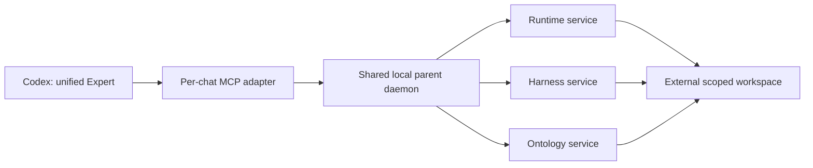

# EvoPilot 0.1.1 Preview

Build domain models, assess quality, and prepare controlled execution through one Expert in Codex. Runtime owns execution and state, Harness owns QA and delivery standards, and Ontology owns domain modeling.

[Quickstart](docs/installation.md) · [Documentation](docs/README.md) · [Downloads](https://github.com/yeliang-wang/evopilot/releases/tag/v0.1.1) · [Contribute](CONTRIBUTING.md)

0.1.1 Preview brings the three products together for local modeling, quality assessment and controlled execution. Preview is not GA or blanket production acceptance. Review drafts and evidence before making business or publication decisions.

## What can I do?

| Scenario | Unified Expert path | Result to review |
| --- | --- | --- |
| Design from requirements | Forward design | Concepts, relations, constraints and proposed mappings |
| Understand an existing project | Reverse modeling of an authorized revision | Observed mappings, inferences and semantic gaps |
| Assess quality | Harness quality assessment | Rules, evidence, missing reports and quality results |
| Plan and execute a goal | Runtime plan/execute | Immutable inputs, decisions, receipts and reconciliation |

Missing evidence stays INDETERMINATE with Warning; it does not become PASS or trigger an automatic version bump. Runtime defaults to inspect-only/unavailable execution until a trusted executor is configured. Selecting the plugin alone does not enable arbitrary coding.

## Three products, one entry

| Repository | Responsibility | Documentation | Releases |
| --- | --- | --- | --- |
| [EvoPilot parent](https://github.com/yeliang-wang/evopilot) | Composition, unified Expert and distribution; Codex plugin is Runtime integration, not a fourth product | [Guides](docs/README.md) | [0.1.1 Preview](https://github.com/yeliang-wang/evopilot/releases/tag/v0.1.1) |
| [Runtime](https://github.com/yeliang-wang/evopilot-runtime) | Projects, goals, execution, state, decisions and audit | [API](https://github.com/yeliang-wang/evopilot-runtime/blob/main/docs/service.md) | [0.1.1 Preview](https://github.com/yeliang-wang/evopilot-runtime/releases/tag/v0.1.1) |
| [Harness](https://github.com/yeliang-wang/evopilot-harness) | QA, evidence, evaluation and delivery standards | [Guide](https://github.com/yeliang-wang/evopilot-harness/blob/main/README.md) | [0.1.1 Preview](https://github.com/yeliang-wang/evopilot-harness/releases/tag/v0.1.1) |
| [Ontology](https://github.com/yeliang-wang/evopilot-ontology) | Domain concepts, relations, modeling, builds and immutable deliveries | [Guide](https://github.com/yeliang-wang/evopilot-ontology/blob/main/README.md) | [0.1.1 Preview](https://github.com/yeliang-wang/evopilot-ontology/releases/tag/v0.1.1) |



The daemon loads all three services; it does not start one process per product. See [process topology](docs/architecture/0002-local-process-topology.md).

## Start with the portable bundle

Use **Node 24.14.0**. Get `evopilot-0.1.1-preview.tar.gz` and `SHA256SUMS` from the exact [v0.1.1 release](https://github.com/yeliang-wang/evopilot/releases/tag/v0.1.1). Follow [checksum verification and extraction](docs/installation.md), then set canonical absolute paths to your extracted bundle and new isolated locations outside Git; their parent directories must exist. Public and private product data belong to the workspace, separate from installed program files:

```sh
preview_bundle="/absolute/path/to/extracted-bundle"
preview_root="/absolute/path/to/new-preview-program"
preview_workspace="/absolute/path/to/new-preview-workspace"
node "$preview_bundle/app/scripts/manage-preview.mjs" install --bundle "$preview_bundle" --root "$preview_root" --workspace "$preview_workspace" --workspace-id preview-workspace --installation-id preview-install
node "$preview_bundle/app/scripts/manage-preview.mjs" doctor --root "$preview_root"
codex plugin marketplace add "$preview_root" --json
codex plugin add evopilot-v01-preview@evopilot-v01-preview-local --json
```

Select **EvoPilot v0.1 Preview**, then say: “Help me design a synthetic library model with Book and Loan; show the draft and unresolved questions before publication.” This activates only the current chat, checks the local daemon and starts it if absent. Inspect and guide requests stay passive. Chats without the plugin ignore this entry; these are integration behaviors, not Host-enforcement claims.

After installation, ordinary work happens through the Expert; routine CLI operations are not required. Native asset authoring needs no LLM callback. Advanced classification and legacy Catalog resolution need trusted callbacks. Continue with the [four first journeys](docs/first-journey.md), [capabilities](docs/capabilities.md), [source development](docs/development.md), or [troubleshooting](docs/recovery.md).

For help, use [support](SUPPORT.md); for sensitive reports, read [security](SECURITY.md). Licensed under [Apache-2.0](LICENSE); attribution is in [NOTICE](NOTICE).
